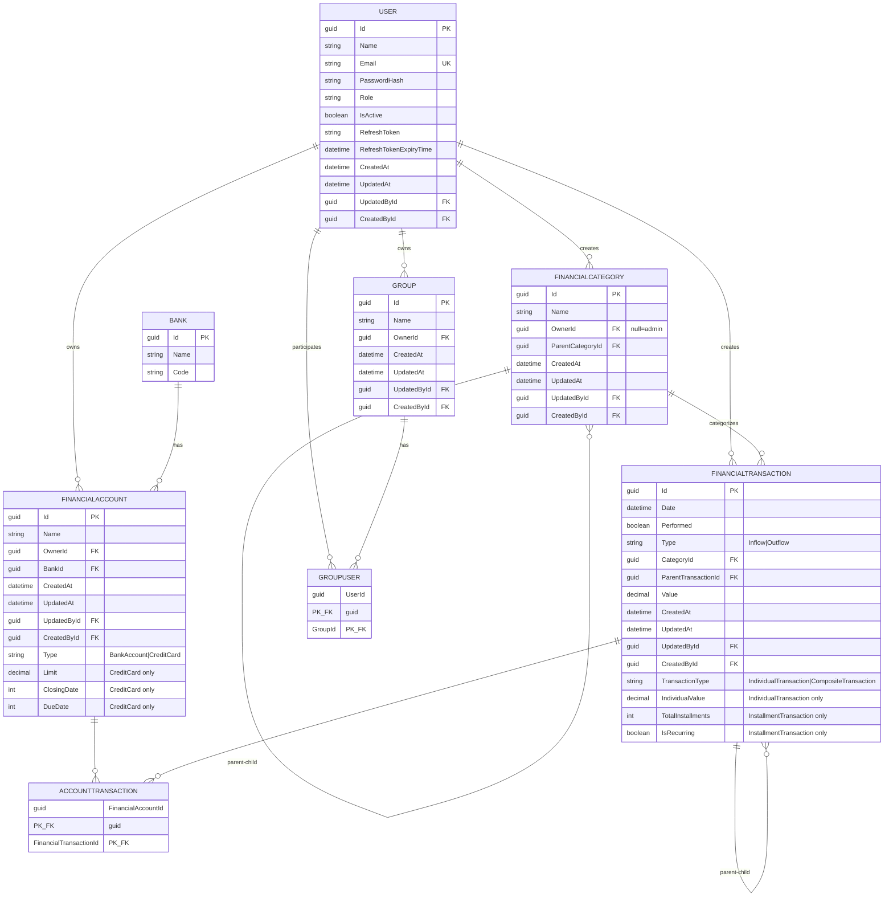

# Meus Pila

Software para gestão de contas bancárias, cartões de crédito, grupos financeiros e divisões financeiras.

## Conceitos Gerais

Todas as entidades do sistema implementam auditoria com os seguintes campos:
- **Id**: Identificador único (GUID)
- **CreatedAt**: Data de criação
- **UpdatedAt**: Data da última atualização
- **CreatedById**: Id do usuário que criou
- **UpdatedById**: Id do usuário que fez a última atualização

---

## Usuário

Define um usuário do sistema. Seus atributos são:
- **Id**: Identificador único (GUID)
- **Nome**: Nome do usuário
- **Email**: Único no sistema
- **PasswordHash**: Hash da senha (não armazenar senha em texto plano)
- **Papel**: Um dos seguintes valores
  - `Admin`: Administrador do sistema, gerencia categorias padrão
  - `GroupManager`: Gerenciador de grupos, pode gerenciar grupos que é owner
  - `User`: Usuário comum
- **IsActive**: Flag indicando se o usuário está ativo
- **RefreshToken**: Token para renovação de JWT
- **RefreshTokenExpiryTime**: Data de expiração do refresh token
- **Auditoria**: CreatedAt, UpdatedAt, CreatedById, UpdatedById

Um usuário começa com papel `User`. Pode ser promovido a `GroupManager` e depois a `Admin`.

## Grupo

Define um grupo de usuários onde divisões financeiras podem ser compartilhadas. 

### Atributos
- **Id**: Identificador único (GUID)
- **Nome**: Nome do grupo
- **Owner**: Usuário que é dono do grupo (pode adicionar e remover membros)
- **GroupUsers**: Coleção de membros (relação muitos-para-muitos com Usuário)
- **Auditoria**: CreatedAt, UpdatedAt, CreatedById, UpdatedById

### Relações
- Relação **n para n** com Usuário via tabela `GroupUser`
- Um usuário pode participar de vários grupos
- Um grupo pode ter vários usuários

### Permissões
- **Owner**: Pode adicionar e remover membros do grupo. Um `GroupManager` é o owner do seu grupo.
- **Membros**: Podem criar divisões e alterar divisões que participam (veja seção "Transação de Divisão")

## Banco

Base de dados de referência dos bancos. Apenas para informações institucionais.

### Atributos
- **Id**: Identificador único (GUID)
- **Nome**: Nome do banco
- **Código**: Código de identificação do banco (número de roteamento)

---

## Conta Financeira

Abstração genérica que representa uma conta com capacidade de armazenar transações.

### Atributos
- **Id**: Identificador único (GUID)
- **Nome**: Nome da conta
- **Owner**: Usuário que é dono da conta
- **Bank**: Referência ao banco (para contas bancárias)
- **Transactions**: Coleção de transações (relação muitos-para-muitos via `AccountTransaction`)
- **Auditoria**: CreatedAt, UpdatedAt, CreatedById, UpdatedById

### Operações
- **GetBalance()**: Calcula o saldo atual (soma de inflows - soma de outflows)
- **GetBalance(filter)**: Calcula o saldo aplicando filtro LINQ (ex: transações de um período)

### Especializações

#### Conta Bancária
Especialização concreta de `FinancialAccount` que herda todos os atributos e operações base. Sem atributos adicionais.

#### Cartão de Crédito
Especialização concreta de `FinancialAccount` com atributos adicionais:
- **Limit**: Limite de crédito da conta
- **ClosingDate**: Dia do fechamento da fatura (1-31)
- **DueDate**: Dia do vencimento da fatura (1-31)

Validações:
- Limite deve ser maior que zero
- Datas de fechamento e vencimento devem ser válidas

## Categoria de Transação Financeira

Define categorias para classificar transações. Suporta hierarquia de categorias.

### Atributos
- **Id**: Identificador único (GUID)
- **Nome**: Nome da categoria
- **Owner**: Usuário dono (NULL para categorias de admin, valor para categorias do usuário)
- **ParentCategory**: Categoria pai (permite criar subcategorias)
- **Auditoria**: CreatedAt, UpdatedAt, CreatedById, UpdatedById

### Tipos de Categoria

#### Categorias de Admin (Padrão)
- Criadas por usuários com papel `Admin`
- `Owner` é NULL
- Imutáveis por usuários regulares
- Disponíveis para todo o sistema

#### Categorias de Usuário
- Criadas por qualquer usuário
- `Owner` contém o Guid do usuário criador
- Só podem ser alteradas pelo criador
- Visíveis apenas para o usuário criador por padrão

### Compartilhamento de Categorias em Grupo
**[Status: Em desenvolvimento]**

Categorias personalizadas poderão ser compartilhadas entre membros de um grupo via configuração explícita. Um usuário pode:
- Criar categorias privadas para uso pessoal
- Configurar quais categorias são compartilhadas com cada grupo que participa
- Outros membros do grupo só veem categorias que foram explicitamente compartilhadas

### Hierarquia
Categorias podem ter uma categoria pai (`ParentCategory`), formando uma estrutura hierárquica. Exemplo:
- Alimentação (pai)
  - Restaurante (filho)
  - Supermercado (filho)

## Transação Financeira

Abstração genérica que representa uma movimentação financeira em uma conta. Todas as transações têm os seguintes atributos:

### Atributos Base
- **Id**: Identificador único (GUID)
- **Date**: Data da transação
- **Performed**: Flag indicando se a movimentação já foi realizada
- **Type**: Tipo de transação (`Inflow` ou `Outflow`)
- **Category**: Categoria da transação
- **ParentTransaction**: Transação pai (para transações que fazem parte de uma transação composta)
- **Value**: Valor da transação (sempre positivo, interpretação de sinal vem do Type)
- **Auditoria**: CreatedAt, UpdatedAt, CreatedById, UpdatedById

### Hierarquia de Transações

```
FinancialTransaction (abstrata)
├── IndividualTransaction
│   └── RecurringTransaction [Status: Em desenvolvimento]
│
└── CompositeTransaction
    ├── InstallmentTransaction [NOTA: será refatorada]
    └── DivisionTransaction [Status: Em desenvolvimento]
```

#### Transação Individual
Tipo concreto que representa uma transação simples de entrada ou saída.

**Propriedades**:
- Herda todas as propriedades base de `FinancialTransaction`
- Armazena um valor fixo em decimal

#### Transação Recorrente
**[Status: Em desenvolvimento]**

Especialização de `IndividualTransaction` para transações que se repetem periodicamente.

**Propriedades adicionais**:
- **Frequency**: Frequência da recorrência (Dia, Mês, Ano)
- **FrequencyModifier**: Número inteiro que modifica a frequência (ex: 2 meses, 15 dias)
- **Occurrences**: Número de vezes que a transação deve ocorrer

**Comportamento**:
- Ao criar uma transação recorrente, o sistema gera automaticamente n cópias da transação individual com base na frequência
- Permite datas específicas (ex: todo dia 5 de cada mês, todo dia 5 de janeiro de cada ano)
- Se uma transação recorrente é alterada, o usuário pode escolher:
  - Alterar apenas a transação atual
  - Alterar a transação atual e todas as futuras

#### Transação Composta
Tipo concreto que é uma agregação de outras transações. O valor final é calculado como:
- **Value = Soma de Inflows - Soma de Outflows** dos filhos

A transação composta herda seu Type do resultado:
- Se Value >= 0: Type = Inflow
- Se Value < 0: Type = Outflow

#### Transação Parcelada
**[Status: A ser refatorada]**

Atualmente implementada como `InstallmentTransaction` (estendendo `CompositeTransaction`), será refatorada para ser especialização apropriada.

**Propriedades**:
- **TotalInstallments**: Número total de parcelas
- **ChildTransactions**: Coleção de transações-filha (uma por parcela)

**Validações**:
- Deve ter no mínimo 2 parcelas
- Todas as parcelas filhas devem ter o mesmo Type (todas Inflow ou todas Outflow)

**Comportamento**:
- Ao alterar o valor total das parcelas, o sistema recalcula as parcelas
- Um usuário pode alterar o valor de uma parcela específica, o que atualiza automaticamente o valor total da transação mãe

#### Transação de Divisão
**[Status: Em desenvolvimento]**

Especialização de `CompositeTransaction` que permite divisão de despesas entre membros de um Grupo.

**Comportamento**:
- Criada por um membro do grupo com um valor total definido
- Gera automaticamente transações individuais nas contas dos participantes
- Membros do grupo podem alterar a divisão, o que recalcula as transações individuais
- A transação pode ser bloqueada pelo criador para impedir alterações

**Exemplo**:
1. Alice pagou R$120 de pizza e quer dividir com Bob e Charlie (3 pessoas iguais)
   - Alice: -R$120 (saída) + R$40 entrada (pagamento de Bob) + R$40 entrada (pagamento de Charlie)
   - Bob: -R$40 (sua parte)
   - Charlie: -R$40 (sua parte)

2. Charlie convida Diana para comer a pizza (4 pessoas agora)
   - Alice: -R$120 + R$30 (Bob) + R$30 (Charlie) + R$30 (Diana)
   - Bob: -R$30
   - Charlie: -R$30
   - Diana: -R$30

---

## Relação Entre Conta Financeira e Transação

Há uma relação **muitos-para-muitos** entre `FinancialAccount` e `FinancialTransaction` via tabela `AccountTransaction`.
- Uma transação pode estar vinculada a múltiplas contas (ex: transações de divisão aparecem em várias contas)
- Uma conta pode ter múltiplas transações

---

## Diagrama de Relacionamentos Entre Entidades



### Explicação das Relações:

| Relação | Tipo | Descrição |
|---------|------|-----------|
| User → Group | 1:n | Um usuário é dono de múltiplos grupos |
| User → GroupUser → Group | n:m | Um usuário participa de múltiplos grupos |
| User → FinancialAccount | 1:n | Um usuário é dono de múltiplas contas |
| User → FinancialCategory | 1:n | Um usuário cria múltiplas categorias |
| User → FinancialTransaction | 1:n | Um usuário cria múltiplas transações |
| Bank → FinancialAccount | 1:n | Um banco tem múltiplas contas |
| FinancialAccount ↔ FinancialTransaction | n:m | Relacionamento via `AccountTransaction` |
| FinancialCategory → FinancialCategory | 1:n | Hierarquia de categorias (pai-filho) |
| FinancialTransaction → FinancialTransaction | 1:n | Hierarquia de transações (composta-filha) |
| FinancialCategory → FinancialTransaction | 1:n | Uma categoria tem múltiplas transações |